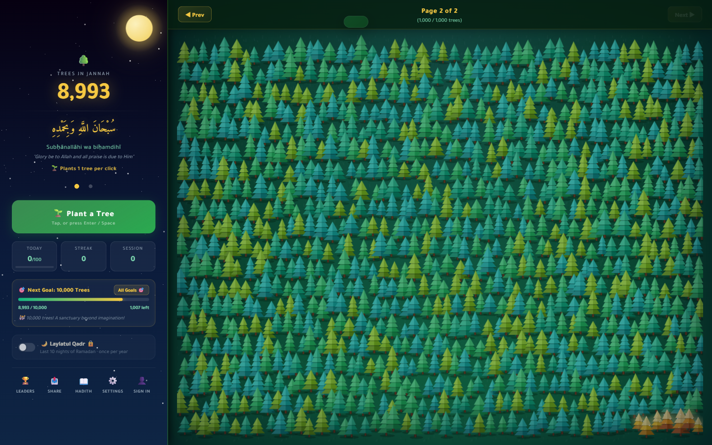

# 🌳 DhikrForest: Dhikr Counter & Digital Tasbih That Plants Trees in Jannah

[](https://dhikrforest.netlify.app/)
[](https://dhikrforest.netlify.app/)
[](LICENSE)

**DhikrForest** is a free, offline-first **dhikr counter** (digital tasbih / tasbeeh counter) for Muslims. Every time you say *Subḥānallāhi wa biḥamdihī* and tap, a tree is planted in your personal forest, a living picture of the trees promised in Jannah.

**▶ Use it now: [dhikrforest.netlify.app](https://dhikrforest.netlify.app/)** (no sign-up, works on phone and desktop, installs as an app)



---

## 🧭 Project Overview

DhikrForest is a counter for remembrance of Allah that you can see. Each tap is one dhikr, and each dhikr plants a tree in a forest that keeps growing page after page. It runs entirely in the browser and keeps working with no internet connection, so it can be used anywhere, like a tasbih in your pocket. If you choose to sign in, your trees also count toward a shared leaderboard. The server checks every update so nobody can fake a score. The app is free and open source, made as an ongoing charity (sadaqah jariyah).

## ✨ Why

> The Prophet ﷺ said: *"Whoever says Subḥānallāhil-ʿAẓīm wa biḥamdihī, a palm tree is planted for him in Paradise."*
> Jāmiʿ at-Tirmidhī 3464

> He ﷺ passed by Abū Hurayrah while he was planting and said: *"Shall I not guide you to plants better than this? Say SubḥānAllāh, wal-ḥamdu lillāh, wa lā ilāha illallāh, wallāhu akbar. For each one, a tree will be planted for you in Paradise."*
> Sunan Ibn Mājah 3807

DhikrForest turns that promise into something you can see grow, one remembrance at a time. It is built as a **sadaqah jariyah**: free forever, open source, no ads.

## 🖥️ Features

| | Feature | Details |
| --- | --- | --- |
| 🌿 | **Two dhikrs** | *Subḥānallāhi wa biḥamdihī* (1 tree) and the four praises (4 trees) |
| 🌴 | **Your garden** | An illustrated garden of palms, blossom, fruit, cypress and fir trees along a river flowing from a palace on the horizon. Dawn, day and night lighting, fireflies and drifting light. 1,000 trees per garden, drawn on canvas so it stays fast |
| 🎯 | **Daily goal & streaks** | Pick 33 / 100 / 300 / 1,000 a day and keep your streak alive |
| 🏆 | **Leaderboard** | Optional Google sign-in with a public nickname. Weekly and all-time boards plus a community total |
| 🌙 | **Laylatul Qadr mode** | ×1000 golden trees, once a year, only in the last ten nights of Ramadan, ending at Fajr (local prayer times) |
| 📲 | **Installable PWA** | Add to your home screen. Works fully offline |
| 🛡️ | **Fair counting** | Holding a key or scripting clicks doesn't plant extra trees. Saved data is tamper-checked, and leaderboard totals are validated server-side |
| 📳 | **Haptics** | A gentle vibration per tap on phones, so you can count without looking |
| 🌅 | **Sky themes** | Dawn, day and night skies follow your clock (or pick one) |
| 📖 | **Hadith references** | The sources behind each dhikr, inside the app |

## 🛡️ How the anti-cheat works

- **Input:** auto-repeat keys are ignored (holding Enter/Space plants once), untrusted script events are dropped, and taps are capped at a human pace.
- **Local data:** the forest is stored as a signed blob. Edits made in DevTools are detected on reload, and the last verified copy is restored.
- **Leaderboard:** [`firestore.rules`](firestore.rules) only accepts increments a human could make since the last sync (server clock), at most 5,000 per write. Laylatul Qadr can be switched on once per 300 days for at most 14 hours. Trees planted before signing in never count.

## 🚀 Development

Requires Node 22+ and [pnpm](https://pnpm.io/).

```bash
pnpm install
pnpm dev          # dev server (add ?now=2027-03-01T21:00 to simulate a Ramadan night)
pnpm build        # type-check + production build with service worker → dist/
pnpm lint         # oxlint
pnpm test:rules   # Firestore security-rule tests (needs Java 21+ for the emulator)
```

Firebase project: `dhikrforest` (Auth with Google, Firestore). Deploy rules with `npx firebase deploy --only firestore`.

## 📁 Project structure

```
src/
├── App.tsx                 # Wiring: state, cloud sync, keyboard guard, modals
├── components/
│   ├── Forest/             # Canvas garden: forestArt (tree sprites), forestScene (sky, river, palace), forestFx (living layer)
│   ├── Panel/              # Counter, dhikr, plant button, stats, Qadr toggle
│   ├── Toolbar/            # Bottom bar, settings and account dialogs
│   ├── Leaderboard/        # Weekly / all-time leaderboard dialog
│   └── Modal/              # Shared dialog
├── firebase/               # Lazy-loaded Firebase (auth, sync, leaderboard)
├── hooks/                  # useForestState, useSavedState, useQadr, useCloud, useCloudSync…
├── lib/                    # forestSegments, secureStore, plantGuard, qadr, share
└── data/zikrs.ts           # Dhikr text and milestones
firestore.rules             # Server-side anti-cheat
tests/                      # Rules tests
```

## 🤝 Contributing

Ideas, translations (Arabic, Urdu, Indonesian, Turkish, French…) and bug reports are very welcome. Open an issue or a pull request. If you share the app with someone, may you share in the reward of every dhikr it inspires.

## 🤲 Intention

This is a gentle aid for the heart, not a replacement for sincerity, focus or presence in worship. The count is a reminder; only Allah knows and rewards what is accepted.

*"And your Lord is not forgetful."* (Maryam 19:64)

## 📄 License

[MIT](LICENSE): free to use, share and build upon.

<sub>Keywords: dhikr counter, zikr counter, online tasbih, digital tasbeeh, tasbih counter app, SubhanAllah counter, Islamic app, Muslim app, Ramadan, Laylatul Qadr, trees in Jannah, sadaqah jariyah.</sub>
